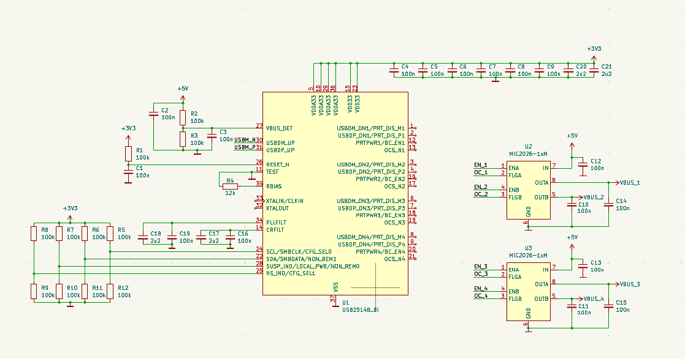
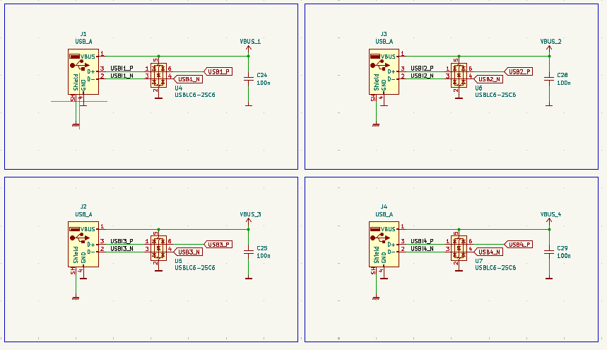
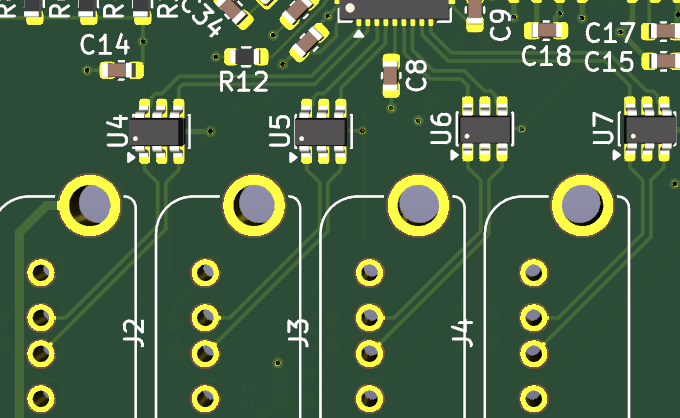
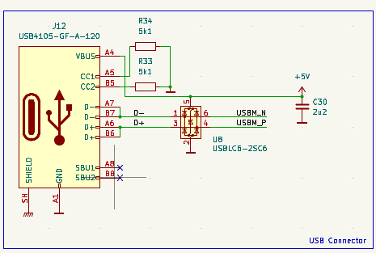
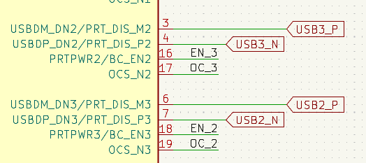
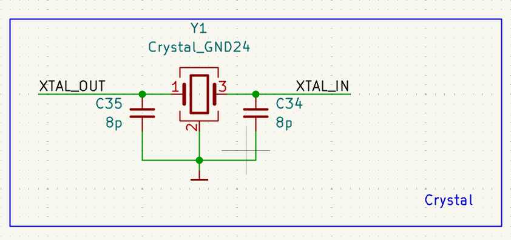
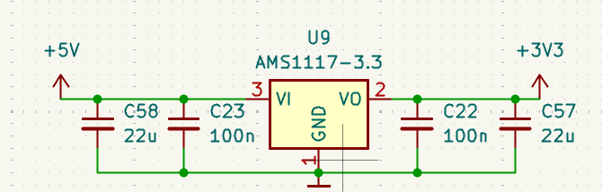
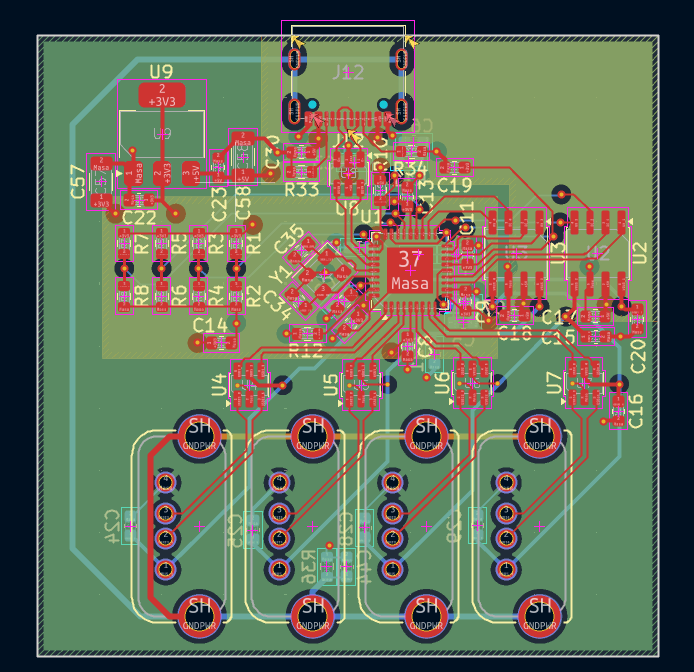
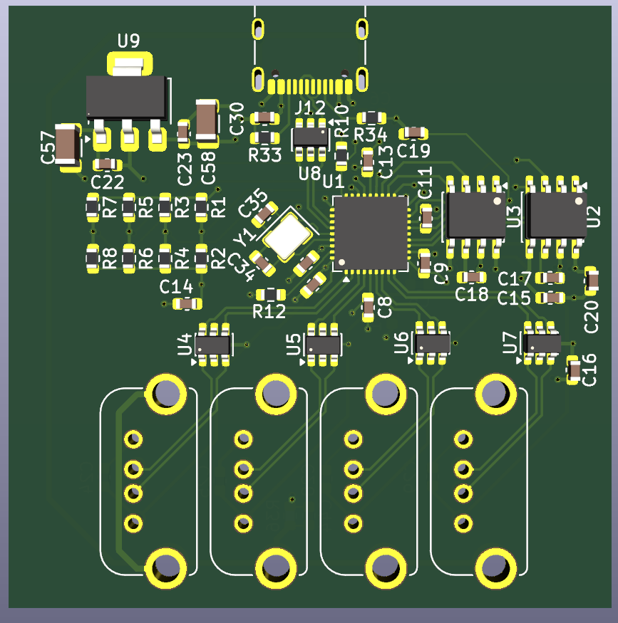

## Oct 7, 2026: Made a basic schematic

I made first part of the schematic. I pretty much finished all the circuitry around the hub IC. I did not finish the oscillator part though. 

Also I finished drawing the 2 power switches. I didn't connect them yet. 

**Total time spent: 30min**

## Oct 8, 2026: Finished schematic and PCB
Schematic is now done.

### USB Ports
Every port has ESD protection, and decoupling caps and of course everything is routed with differential pairs.

And host port is USB-C. I decided that this option is a lot more versitale even if other ports are USB-A.

Also I had to swap channel 2 and 3 around to make routing easier. Otherwise USB traces would overlap and I would have to use vias. I could make it work but this way is far better.

### Crystal
Crystal is also done.

It's a 24MHz crystal.
When choosing caps for the crystal I had to accound for the capacitance to ground plane. That's why I went with lower value than stated in the datasheet.

### Other

I also made a voltage regulator:

### PCB
It a 4-layer board. It's mostly finished but I'll have to double check everything.

**Total time spent: 150min**

## Oct 7, 2026: Cleanup and maintenance

I made sure that everything is finished.

I also generated gerbers, exported BOM and made a nice readme.

Schematic is now organized too.

**Total time spent: 30min**